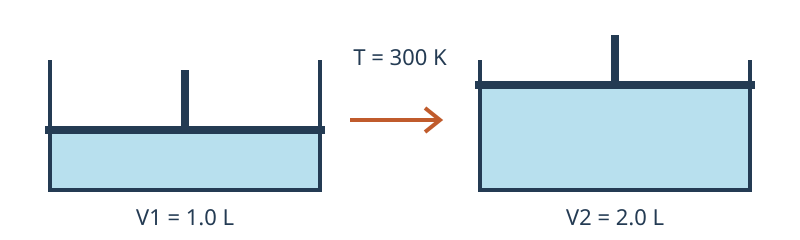

# 理想气体的等温膨胀：原创两页示例

本例的正文、公式选择、数据和示意图均为本仓库原创合成材料，按仓库许可证提供。没有摘录教材，也没有调用云端 OCR。`source/original.pdf` 是两页源文；`source/raw/` 中的 JSON 是手工构造的 MinerU 格式 fixture，用来测试装配接口，不是识别质量报告。

## 第一页：过程与功的约定

取一摩尔理想气体，温度保持为 300 K。气体从 1.0 L 可逆膨胀到 2.0 L。忽略其他形式的功，采用“环境对系统做功为正”的约定。

$$
pV=nRT
$$

下图只表示体积增大，活塞位置不按比例绘制。



气体膨胀时外压沿可逆路径变化，体积功为：

$$
w=-\int_{V_1}^{V_2}p_{\mathrm{ext}}\,\mathrm{d}V=-nRT\ln\frac{V_2}{V_1}
$$

## 第二页：能量核对

理想气体的内能只依赖温度，等温过程的内能变化为零。根据热力学第一定律，气体吸收的热量与环境对系统做的功互相抵消。

$$
\Delta U=q+w=0
$$

为便于复算，气体常数取 8.314 J/(mol·K)，结果保留到整数焦耳。以下数据是上述假设下的计算值，不是实验测量值。

| 量 | 计算值 | 说明 |
| --- | --- | --- |
| 体积比 | 2 | 终态体积除以初态体积 |
| 环境对系统做功 | −1729 J | 膨胀功为负 |
| 系统吸热 | 1729 J | 维持等温 |

$$
q=-w\approx 1729\,\mathrm{J}
$$

这组结论仅适用于这里给出的理想气体、等温可逆路径和功的符号约定。

## 复现与审计

`manifest.json` 将两页各作为一个分片，`chapters.json` 将它们装成一个内容文件。物理页码从 1 开始，各片内 `page_idx` 从 0 开始；两个分片都含 `page_idx=0` 是预期情况。

从合集仓库根目录执行：

```bash
python skills/sanmu-doc2md/scripts/build_markdown.py --raw examples/sanmu-doc2md/book-demo/source/raw \
  --out ./demo-output --mode book \
  --manifest examples/sanmu-doc2md/book-demo/manifest.json --chapters examples/sanmu-doc2md/book-demo/chapters.json \
  --pdf examples/sanmu-doc2md/book-demo/source/original.pdf
python skills/sanmu-doc2md/scripts/validate_output.py ./demo-output --images-dir images --json
python skills/sanmu-doc2md/scripts/extract_formulas.py ./demo-output --out ./demo-formulas.json
node skills/sanmu-doc2md/scripts/validate_math.cjs ./demo-formulas.json
python skills/sanmu-doc2md/scripts/preview_server.py ./demo-output --port 8766 --katex-dir skills/sanmu-doc2md/scripts/node_modules/katex/dist
```

预期是 1 个内容文件加 1 个导航、4 个独立公式、1 张示意图和 1 个文本表格。逐项对照两页源 PDF；在浏览器打开内容页，查看公式、图片、表格和目录。图由源 PDF 裁切时，像素数与 SVG 不同是正常现象。

`source/fixture-info.json` 记录来源声明、期望计数和审计要点。只对 `demo-output` 执行校验，避免把本说明中的代码片段和源文公式计入产物统计。完整操作见技能 [README](../../../skills/sanmu-doc2md/README.md)。
